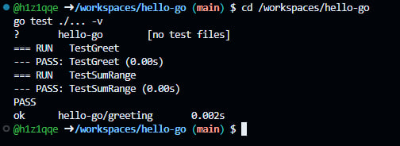
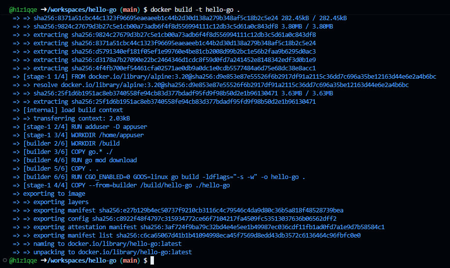
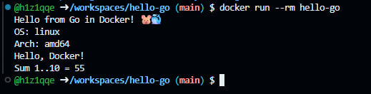
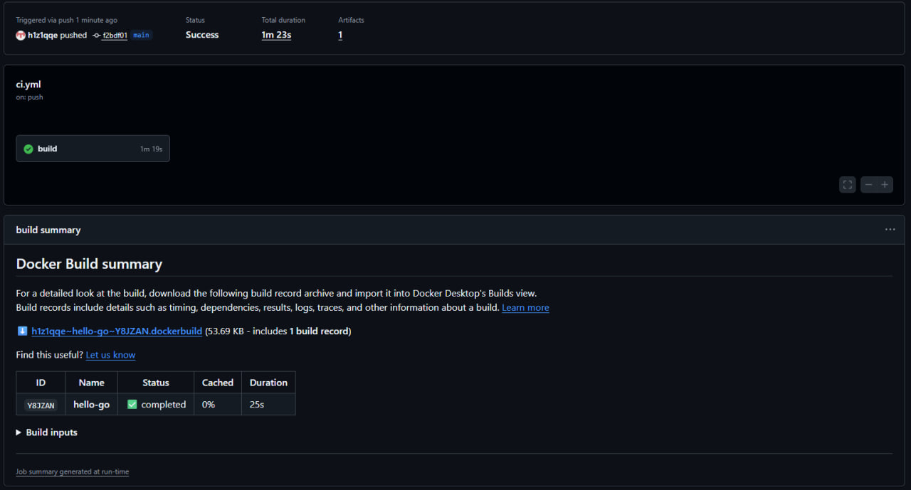
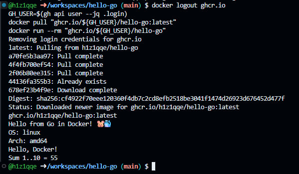

<div align="center">

# 🐹 hello-go

**Лабораторная работа: CI/CD для Go — от `gofmt` до Docker-образа в GitHub Container Registry**

[](https://github.com/h1z1qqe/hello-go/actions/workflows/ci.yml)
[](https://github.com/users/h1z1qqe/packages/container/package/hello-go)
[](https://codespaces.new/h1z1qqe/hello-go)

```bash
docker pull ghcr.io/h1z1qqe/hello-go:latest
```

*Вся работа — код, тесты, сборка образа и публикация — выполнена в облаке, в GitHub Codespaces.*

</div>

---

## 📖 О проекте

Учебный проект, демонстрирующий полный цикл **CI/CD**: при каждом push в `main` GitHub Actions проверяет код (форматирование, `go vet`, тесты), собирает минималистичный Docker-образ и публикует его в **GHCR** — реестре контейнеров GitHub. Никаких отдельных учётных записей и ручных токенов: публикация выполняется встроенным `GITHUB_TOKEN`, который выдаётся каждому запуску workflow автоматически.

Главная особенность Go здесь — **статическая компиляция**: `CGO_ENABLED=0 go build` собирает один бинарник (~1.4 МБ), которому для запуска не нужны ни компилятор, ни JVM, ни интерпретатор. Поэтому финальный образ на `alpine:3.20` получается крошечным — только базовая система и бинарник.

Ключевое отличие **CI** от **CI/CD**:

- **CI** (Continuous Integration) — код проверяется: `gofmt`, `vet`, `test`, `docker build`;
- **CI/CD** (Continuous Delivery) — то же самое, плюс образ публикуется в реестр и сразу готов к развёртыванию на любой машине с Docker.

## ✅ Проделанная работа

| # | Этап | Инструменты | Результат |
|---|---|---|---|
| 1 | Создание репозитория и запуск Codespace | GitHub, Codespaces | облачная среда с предустановленными `git`, `gh` и Docker |
| 2 | Каркас проекта | `go mod` | пакет `greeting` + CLI-приложение, 2 unit-теста |
| 3 | Multi-stage `Dockerfile` | Docker | компиляция в `golang:1.23-alpine`, запуск в `alpine:3.20` |
| 4 | Локальные проверки | `gofmt` / `go vet` / `go test` | 0 замечаний линтера, **2 PASS** |
| 5 | Локальная сборка и запуск | `docker build` / `docker run` | образ собран, вывод корректен — скриншоты 1–3 |
| 6 | Публикация кода | `git push` в `main` | автоматически запустил workflow |
| 7 | Прогон CI/CD-конвейера | GitHub Actions | ✅ **Success** — скриншот 4 |
| 8 | Публикация образа | GHCR + `GITHUB_TOKEN` | `ghcr.io/h1z1qqe/hello-go:latest` + `:<COMMIT_SHA>` |
| 9 | Проверка образа из реестра | `docker pull` / `docker run` | вывод идентичен локальному — скриншот 5 |

### 📊 Итоги CI-прогона

| Метрика | Значение |
|---|---|
| Коммит | `<COMMIT_SHA>` — push в `main` |
| Статус workflow | ✅ **Success** |
| Общее время прогона | `<ВРЕМЯ_CI>` |
| Тесты | 2 passed, 0 failed |
| Digest образа | `<DIGEST>` (из вывода `docker pull`) |

## ⚙️ Как работает конвейер

```text
push в main
   │
   ▼
┌──────────────────────────────────────────────────────┐
│   GitHub Actions — workflow «Go CI/CD»               │
│                                                      │
│   1. gofmt -l .                форматирование  ✅   │
│   2. go vet ./...              линтер          ✅   │
│   3. go test ./... -v          2 passed        ✅   │
│   4. go build                  статич. бинарник ✅   │
│   5. docker build              multi-stage     ✅   │
│   6. docker push               → GHCR          ✅   │
└──────────────────────────────────────────────────────┘
   │
   ▼
ghcr.io/h1z1qqe/hello-go:latest  +  :<COMMIT_SHA>
```

Образ собирается в два этапа: в `builder` (на базе `golang:1.23-alpine`) компилируется статический бинарник с флагами `-ldflags="-s -w"` (без таблиц символов и отладочной информации), затем он копируется в чистый `alpine:3.20` и запускается от непривилегированного пользователя `appuser`. В финальный образ не попадают ни компилятор, ни исходники, ни кэш модулей.

## 🖼 Скриншоты

### 1. Тесты в Codespaces

`go test ./... -v` — `TestGreet` и `TestSumRange` проходят.



### 2. Сборка Docker-образа

`docker build -t hello-go .` — multi-stage сборка: стадии builder и runtime, экспорт слоёв и итогового образа `hello-go:latest`.



### 3. Запуск контейнера локально

`docker run --rm hello-go` — приложение выводит приветствие, платформу, результат `Greet()` из пакета `greeting` и сумму чисел 1..10.



### 4. GitHub Actions — успешный CI/CD-прогон

Workflow «Go CI/CD» завершился со статусом **Success** после пуша в `main`. В summary — статистика Docker-сборки из `build-push-action`.



### 5. Проверка образа из реестра GHCR

`docker pull ghcr.io/${GH_USER}/hello-go:latest` — образ скачан из реестра без авторизации, затем `docker run` — вывод полностью совпадает с локальной сборкой.



## 🚀 Запуск

### Образ из реестра (публичный, без авторизации)

```bash
docker pull ghcr.io/h1z1qqe/hello-go:latest
docker run --rm ghcr.io/h1z1qqe/hello-go
```

### Локальная сборка из исходников

```bash
git clone https://github.com/h1z1qqe/hello-go.git
cd hello-go
docker build -t hello-go .
docker run --rm hello-go
```

Ожидаемый вывод:

```text
Hello from Go in Docker! 🐹🐳
OS: linux
Arch: amd64
Hello, Docker!
Sum 1..10 = 55
```

### Передача аргументов (ENTRYPOINT)

`ENTRYPOINT` в Dockerfile принимает аргументы — приложение их распечатает:

```bash
docker run --rm ghcr.io/h1z1qqe/hello-go первый второй
```

```text
Hello from Go in Docker! 🐹🐳
OS: linux
Arch: amd64
Hello, Docker!
Sum 1..10 = 55
Аргументы:
  1: первый
  2: второй
```

<details>
<summary><b>Запустить тесты без установки Go</b> (в контейнере)</summary>

```bash
mkdir -p ~/.go-docker-cache
docker run --rm \
  -u "$(id -u):$(id -g)" \
  -e HOME=/tmp \
  -e GOPATH=/tmp/go \
  -e GOCACHE=/tmp/go-cache \
  -v "$(pwd)":/app \
  -v ~/.go-docker-cache:/tmp/go \
  -w /app \
  golang:1.23-alpine \
  go test ./... -v
```

</details>

## 🗂 Структура проекта

```text
hello-go/
├── .github/
│   └── workflows/
│       └── ci.yml            # конвейер CI/CD → GHCR
├── docs/
│   └── screenshots/          # скриншоты для README
├── greeting/
│   ├── greeting.go           # Greet() и SumRange()
│   └── greeting_test.go      # unit-тесты
├── .dockerignore
├── .gitignore
├── Dockerfile                # multi-stage: golang:1.23-alpine → alpine:3.20
├── go.mod                    # module hello-go, go 1.23
└── main.go                   # CLI-приложение
```

## 🧱 Технологии

| Технология | Как используется |
|---|---|
| **Go 1.23** | пакет `greeting` + CLI; статический бинарник: `CGO_ENABLED=0`, `-ldflags="-s -w"` — всего ~1.4 МБ |
| **Docker multi-stage** | компиляция в `golang:1.23-alpine`, запуск в `alpine:3.20` под непривилегированным пользователем `appuser` |
| **GitHub Actions** | gofmt → vet → test → build → push; кэш Go-модулей (`setup-go`) и Docker-слоёв (GHA cache) |
| **GHCR** | автоматическая публикация образа с тегами `latest` и коротким SHA коммита |
| **GitHub Codespaces** | облачная среда разработки: Docker, git и gh CLI предустановлены и авторизованы |

## 🧪 Тесты

| Тест | Что проверяет |
|---|---|
| `TestGreet` | `Greet("Docker")` → `"Hello, Docker!"` |
| `TestSumRange` | `SumRange(1, 10)` → `55` |

## 🔗 Полезные ссылки

- [Репозиторий](https://github.com/h1z1qqe/hello-go) — исходный код
- [Workflow «Go CI/CD»](https://github.com/h1z1qqe/hello-go/actions/workflows/ci.yml) — история запусков
- [Пакет в GHCR](https://github.com/users/h1z1qqe/packages/container/package/hello-go) — версии образа и инструкция pull
